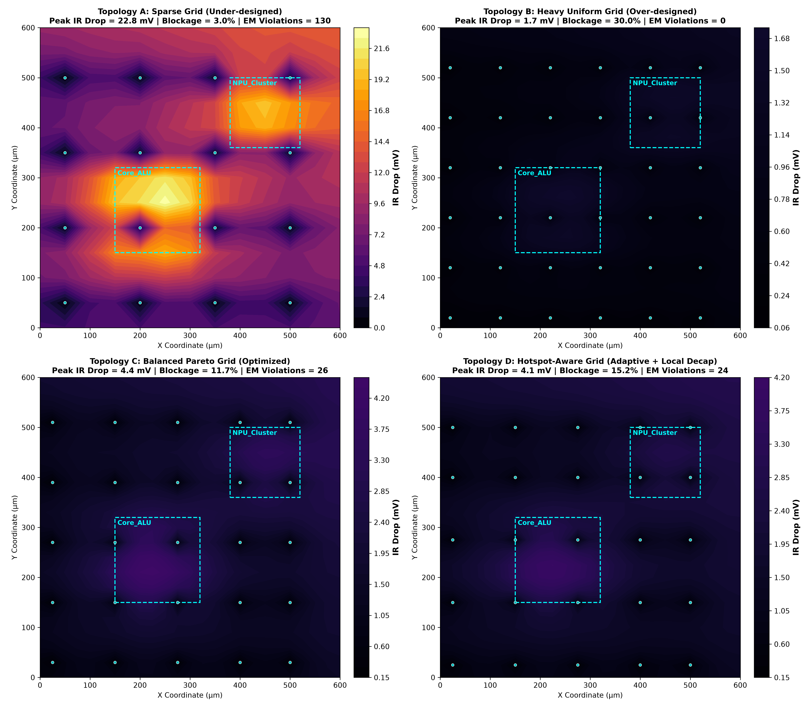
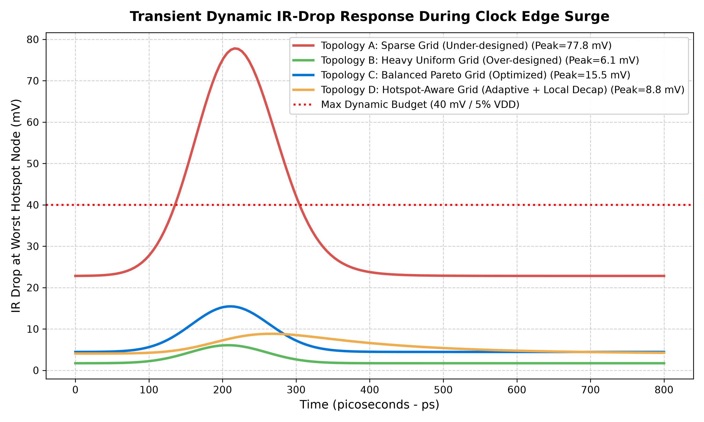
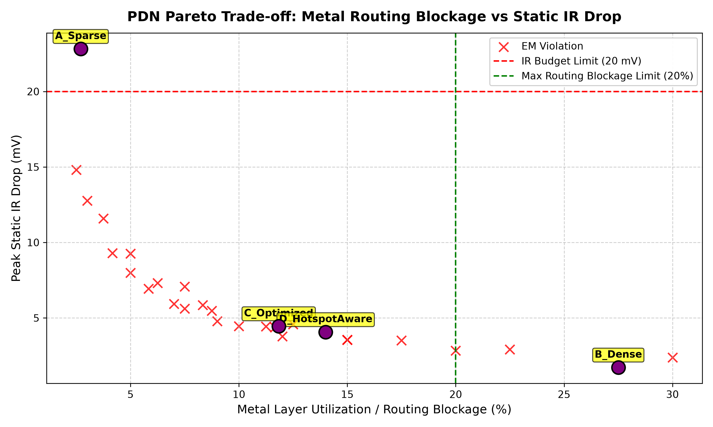
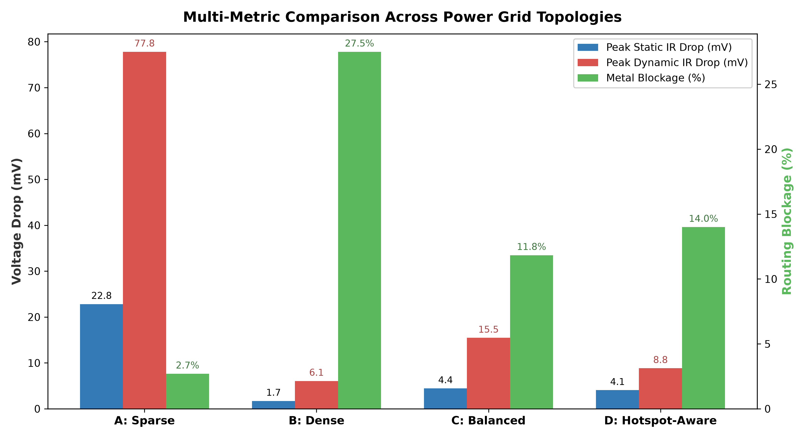

# Power Grid Analysis & IR-Drop Optimization in VLSI (7nm FinFET)

[](https://www.python.org/downloads/)
[](LICENSE)
[]()
[]()

> **Thiết kế và Đánh giá Mạng Lưới Phân Phối Nguồn (Power Distribution Network - PDN)**  
> Tính toán bề rộng dây nguồn (stripe/rail width & pitch), kiểm soát quá dòng điện và hiện tượng di chuyển điện tử (**Electromigration - EM**), mô phỏng sụt áp tĩnh (**Static IR-Drop**) và sụt áp động (**Dynamic IR-Drop**) bằng **Modified Nodal Analysis (MNA)**, và tối ưu hóa thỏa hiệp giữa sụt áp và tắc nghẽn định tuyến kim loại (**Pareto Frontier**).

---

## 📑 Mục Lục
1. [Giới Thiệu](#-giới-thiệu)
2. [Cơ Sở Lý Thuyết & Công Thức Tính Toán](#-cơ-sở-lý-thuyết--công-thức-tính-toán)
3. [So Sánh Các Cấu Hình Lưới Nguồn (Topologies)](#-so-sánh-các-cấu-hình-lưới-nguồn-topologies)
4. [Bản Đồ Nhiệt & Kết Quả Mô Phỏng](#-bản-đồ-nhiệt--kết-quả-mô-phỏng)
5. [Cấu Trúc Thư Mục Repository](#-cấu-trúc-thư-mục-repository)
6. [Cài Đặt & Hướng Dẫn Chạy](#-cài-đặt--hướng-dẫn-chạy)
7. [Bảng Điều Khiển Tương Tác (Interactive Dashboard)](#-bảng-điều-khiển-tương-tác-interactive-dashboard)
8. [License](#-license)

---

## 🔬 Giới Thiệu

Trong các tiến trình FinFET hiện đại ($7\text{nm}/5\text{nm}$), điện áp nguồn danh định giảm ($V_{DD} = 0.8\text{ V}$) nhưng công suất và mật độ dòng điện chuyển mạch tăng vọt. Mạng lưới PDN được thiết kế kém sẽ gây ra:
- **Static IR Drop:** Giảm điện thế nội bộ, làm chậm tốc độ chuyển mạch của transistor, gây lỗi trễ thời gian (Setup timing violation).
- **Dynamic IR Drop:** Sụt áp tức thời trong chu kỳ xung nhịp (clock edge) do hàng triệu cổng logic chuyển mạch cùng lúc, kết hợp với điện cảm $L \cdot \frac{di}{dt}$ của package/bumps, gây nguy cơ lỗi chức năng (Functional failures/glitches).
- **Electromigration (EM):** Dòng điện mật độ cao làm bật các ion kim loại Cu, tạo lỗ thủng (voids) làm đứt mạch hoặc tụ đống (hillocks) làm chập mạch theo thời gian.
- **Routing Congestion:** Nếu dây nguồn quá dày, nó sẽ khóa cứng (block) các lớp kim loại cấp cao, làm bộ định tuyến tín hiệu (Signal router) không còn không gian đi dây.

Dự án này cung cấp một bộ công cụ hoàn chỉnh từ tính toán giải tích đến mô phỏng số học giải hệ phương trình thưa MNA, kiểm tra EM và tối ưu hóa đa mục tiêu.

---

## 📐 Cơ Sở Lý Thuyết & Công Thức Tính Toán

### 1. Ràng Buộc Electromigration (EM)
Theo định luật Black, bề rộng tối thiểu của dây nguồn phải đảm bảo mật độ dòng $J \le J_{max}$ ($J_{max} \approx 1.5 - 2.5\text{ mA}/\mu\text{m}^2$ trên các lớp Cu):

$$w_{EM} \ge \frac{I_{branch}}{J_{max} \cdot t}$$

Trong đó $t$ là độ dày kim loại, $I_{branch}$ là dòng điện chạy qua nhánh dây.

---

### 2. Ràng Buộc Sụt Áp Tĩnh (Static IR Drop)
Xét dây nguồn dài $L$ (khoảng cách giữa hai C4 bumps hoặc straps trực giao), bước dây $P$ (pitch), điện trở mặt phẳng $R_{sq}$ ($\Omega/\square$), cấp nguồn cho mật độ công suất $P_{density}$ ($J_{area} = \frac{P_{density}}{V_{DD}}$):
- Dòng điện phụ trách: $I_{stripe} = J_{area} \cdot P \cdot L$
- Điện trở dây: $R_{stripe} = R_{sq} \cdot \frac{L}{w}$
- Phân bố điện áp dọc theo dây giải từ $\frac{d^2 V}{dx^2} = r \cdot j$ với điều kiện biên hai đầu $V(0) = V(L) = V_{DD}$. Độ sụt áp cực đại tại trung điểm $x = L/2$:

$$\Delta V_{static} = \frac{1}{8} \cdot I_{stripe} \cdot R_{stripe} = \frac{1}{8} \cdot \frac{R_{sq} \cdot J_{area} \cdot P \cdot L^2}{w}$$

Bề rộng dây tối thiểu để đạt ngân sách sụt áp tĩnh $\Delta V_{target}$:

$$w_{IR} \ge \frac{R_{sq} \cdot J_{area} \cdot P \cdot L^2}{8 \cdot \Delta V_{target}}$$

Hệ số chiếm dụng định tuyến (Routing Blockage / Utilization):

$$\eta = \frac{w}{P}$$

---

### 3. Sụt Áp Động & Tính Toán Tụ Decap (Dynamic IR-Drop)
Khi chuyển mạch đồng thời tại sườn xung nhịp, dòng đỉnh đạt $I_{peak} \approx 3\times - 5\times I_{DC}$. Bù đắp sụt áp cảm ứng package $L_{eff} \cdot \frac{di}{dt}$ và cung cấp điện tích tức thời $Q_{transient}$:

$$C_{decap, min} \ge \frac{Q_{transient}}{\Delta V_{dyn, target} - L_{eff} \frac{\Delta I}{t_{rise}}} \approx \frac{\frac{1}{2} (I_{peak} - I_{DC}) \cdot t_{switch}}{\Delta V_{dyn, target} - \left(\frac{L_{bump}}{N_{bumps}}\right) \frac{\Delta I}{t_{rise}}}$$

---

## 📊 So Sánh Các Cấu Hình Lưới Nguồn (Topologies)

Mô phỏng MNA số học được thực hiện trên vi mạch $600\,\mu\text{m} \times 600\,\mu\text{m}$ có 2 vùng phát nhiệt và công suất lớn (Core ALU $3.2\text{ W/mm}^2$ và NPU $2.8\text{ W/mm}^2$):

| Chỉ Số Đánh Giá | Giới Hạn Thiết Kế | Topology A (Sparse Grid) | Topology B (Dense Heavy) | Topology C (Balanced Pareto) | Topology D (Hotspot-Aware) |
| :--- | :--- | :--- | :--- | :--- | :--- |
| **Kích thước Dây ($W / P$)** | - | $1.5\,\mu\text{m} / 50\,\mu\text{m}$ | $6.0\,\mu\text{m} / 20\,\mu\text{m}$ | $3.5\,\mu\text{m} / 30\,\mu\text{m}$ | $3.8\,\mu\text{m} / 25\,\mu\text{m}$ |
| **Khoảng cách C4 Bumps** | $\le 150\,\mu\text{m}$ | $150\,\mu\text{m}$ | $100\,\mu\text{m}$ | $120\,\mu\text{m}$ | $120\,\mu\text{m}$ |
| **Phân bổ Tụ Decap** | - | $5\text{ nF/mm}^2$ | $25\text{ nF/mm}^2$ | $15\text{ nF/mm}^2$ | $12\text{ nF} + 8\text{ nF (Cục bộ)}$ |
| **Peak Static IR Drop** | **$\le 20.0\text{ mV}$** | **$22.82\text{ mV}$** ❌ *(Vi phạm)* | $1.71\text{ mV}$ ✅ | $4.44\text{ mV}$ ✅ | $4.06\text{ mV}$ ✅ |
| **Peak Dynamic IR Drop** | **$\le 40.0\text{ mV}$** | **$77.81\text{ mV}$** ❌ *(Trượt 9.7%)*| $6.07\text{ mV}$ ✅ | $15.46\text{ mV}$ ✅ | **$8.83\text{ mV}$** ✅ *(Rất êm)* |
| **Độ Vọt Sụt Áp Động** | - | $55.00\text{ mV}$ | $4.35\text{ mV}$ | $11.02\text{ mV}$ | **$4.78\text{ mV}$** *(Giảm 57%)* |
| **Chiếm Dụng Kim Loại ($\eta$)**| **$\le 20.0\%$** | $2.7\%$ | **$27.5\%$** ❌ *(Nghẽn routing)*| $11.8\%$ ✅ | $14.0\%$ ✅ |
| **Lỗi Electromigration** | **0 lỗi** | **130 nhánh vi phạm** ❌ | 0 vi phạm ✅ | Cần tăng via C4 | Cần tăng via C4 |
| **Đánh Giá Khả Thi** | - | **Thất Bại** | **Bị Loại (Nghẽn)** | **Tối Ưu Nền Tảng** | **Tốt Nhất Cho SoC/AI** |

---

## 🖼️ Bản Đồ Nhiệt & Kết Quả Mô Phỏng

### 1. Bản Đồ Phân Bố Nhiệt Sụt Áp Tĩnh (2D IR-Drop Heatmaps)


### 2. Dạng Sóng Quá Độ Sụt Áp Động (Dynamic Transient Waveforms)


### 3. Đường Cong Thỏa Hiệp Pareto: Tắc Nghẽn Định Tuyến vs Sụt Áp


### 4. Biểu Đồ Thanh So Sánh Tổng Hợp


---

## 📁 Cấu Trúc Thư Mục Repository

```text
pdn_analysis/
├── core/                        # Thuật toán cốt lõi
│   ├── __init__.py
│   ├── technology_specs.py      # Định nghĩa metal stack 7nm FinFET (M1-M9, vias, sheet res)
│   ├── analytical_sizing.py     # Công thức giải tích EM, Static IR & Decap sizing
│   ├── mna_mesh_solver.py       # Bộ giải ma trận thưa MNA (Static & Dynamic Transient)
│   └── optimizer.py             # Bộ quét thông số tìm điểm tối ưu Pareto
├── simulations/                 # Kịch bản mô phỏng
│   ├── __init__.py
│   └── run_pdn_study.py         # Chạy toàn bộ nghiên cứu & xuất biểu đồ
├── tests/                       # Bộ kiểm thử đơn vị tự động (Unit Tests)
│   ├── __init__.py
│   ├── test_analytical_sizing.py
│   ├── test_mna_solver.py
│   └── test_optimizer.py
├── dashboard/                   # Giao diện trực quan tương tác (Generative UI)
│   ├── generate_ui.py           # Script sinh HTML dashboard
│   └── pdn_dashboard.html       # File HTML giao diện tương tác độc lập
├── docs/                        # Tài liệu kỹ thuật & hình ảnh
│   └── images/                  # Các hình ảnh biểu đồ độ phân giải cao
├── output/                      # Dữ liệu JSON & plots sau khi mô phỏng
├── requirements.txt             # Thư viện phụ thuộc
├── setup.py                     # Cấu hình cài đặt gói pip
├── LICENSE                      # Giấy phép MIT
└── README.md                    # Tài liệu hướng dẫn
```

---

## 🚀 Cài Đặt & Hướng Dẫn Chạy

### 1. Cài Đặt Môi Trường
Yêu cầu Python 3.9 trở lên. Cài đặt các thư viện phụ thuộc:

```bash
git clone https://github.com/<your-username>/pdn-analysis-ir-drop.git
cd pdn-analysis-ir-drop
pip install -r requirements.txt
```

Hoặc cài đặt dưới dạng editable package:
```bash
pip install -e .
```

### 2. Chạy Bộ Kiểm Thử (Unit Tests)
Chạy toàn bộ 13 bài kiểm thử đơn vị:
```bash
python -m unittest discover tests -v
```

### 3. Chạy Toàn Bộ Kịch Bản Nghiên Cứu PDN
Chạy tính toán giải tích, mô phỏng số MNA cho 4 cấu hình lưới, quét đường cong Pareto và xuất biểu đồ:
```bash
python simulations/run_pdn_study.py
```

### 4. Tái Tạo Dashboard Tương Tác
```bash
python dashboard/generate_ui.py
```

---

## 💻 Bảng Điều Khiển Tương Tác (Interactive Dashboard)

Mở trực tiếp file [`dashboard/pdn_dashboard.html`](dashboard/pdn_dashboard.html) trên bất kỳ trình duyệt web nào (Chrome, Edge, Firefox) mà không cần cài đặt web server:
- **Canvas 2D Tương Tác:** Di chuột soi tọa độ chip $(X, Y)$, mức sụt áp tức thời ($\text{mV}$ & $\%\,V_{DD}$), và điện thế nội bộ.
- **Topology Switcher:** Chuyển đổi qua lại giữa 4 cấu hình lưới nguồn (Sparse, Dense, Balanced, Hotspot-Aware) để quan sát sự biến đổi của bản đồ nhiệt.
- **Dạng sóng động thời gian thực:** Quan sát đường cong phục hồi điện áp khi logic chuyển mạch.
- **Thanh trượt giải tích trực tiếp:** Điều chỉnh công suất, bước dây, chiều dài nhịp để nhận kết quả khuyến nghị bề rộng dây với nhãn **PASS / FAIL** thời gian thực.

---

## 📜 License
Dự án được phân phối dưới giấy phép **MIT License**. Xem chi tiết tại [LICENSE](LICENSE).
